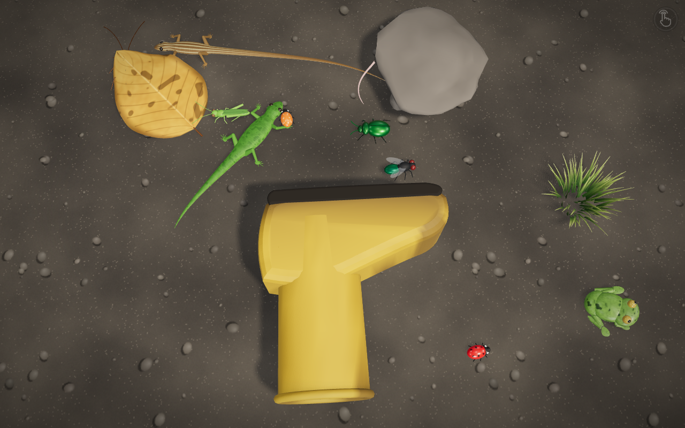
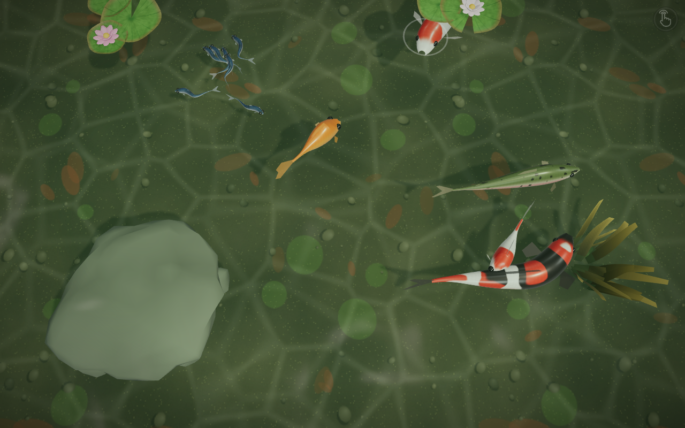
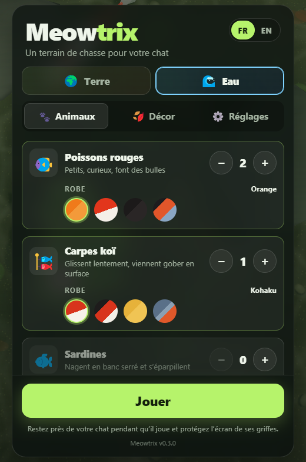

# Meowtrix

Un site plein écran pour faire jouer les chats : des animaux en 3D (Three.js) qui se promènent,
se cachent, et détalent quand une patte les touche. Deux thèmes : **Terre** (lézards, grenouilles,
insectes, souris, écureuils, oiseaux) et **Eau** (poissons rouges, carpes koï, sardines en banc,
truites, saumons, bébés requins). Les sons sont synthétisés en direct (Web Audio API), avec un
réglage du volume, et, si on l'autorise, le micro fait sursauter les animaux aux bruits de la pièce.

**👉 Jouer : [meowtrix.mbonnici.fr](https://meowtrix.mbonnici.fr/)**





| Menu — Animaux | Menu — Décor | Menu — Eau |
| --- | --- | --- |
|  |  |  |

## Ce qu'il y a dedans

- **Terre** : lézards, lézards à longue queue, grenouilles, mouches, coccinelles, scarabées,
  sauterelles, cafards, souris, écureuils, oiseaux. Chaque espèce a plusieurs robes au choix.
- **Eau** : poissons rouges, carpes koï, sardines (en banc), truites, saumons, bébés requins.
  Un toucher fait des ronds dans l'eau ; les koï viennent gober en surface ; les poissons
  contournent les rochers ou plongent dessous pour s'y cacher.
- **Sols** : roche, sable, nuit, béton, parquet, pelouse ; et sous l'eau étang, lagon, rivière.
- **Cachettes** (à combiner) : feuilles, pierres, herbe, tulipes, vieille botte (assez grande pour
  qu'un lézard ou une souris y disparaisse) ; nénuphars, rochers, algues.
- **Réglages** : vitesse, volume des sons (curseur), réaction aux bruits du micro.

## Développement

```bash
npm install
npm run dev        # http://localhost:5173
npm run build      # vérifie les types et produit dist/
```

La version affichée en bas du menu vient de `package.json`.

## Docker

```bash
# Test local sur http://localhost:8787
docker compose -f docker-compose.yml -f compose.local.yml up --build
```

Sur Coolify : ressource **Docker Compose** pointant sur ce dépôt (`docker-compose.yml`), domaine
`https://meowtrix.mbonnici.fr` sur le service `meowtrix` (port 80). Le HTTPS est nécessaire pour le micro.

## Structure

| Dossier | Rôle |
| --- | --- |
| `src/catalog.ts` | Thèmes, espèces (icône, nombre max, robes), sols et cachettes de chaque thème |
| `src/game/body/` | Briques communes : colonne vertébrale simulée, peau lofée, IK des pattes |
| `src/game/creature.ts` | Base des animaux pilotés par un cerveau (locomotion, collisions) |
| `src/game/brain.ts`, `species.ts` | Comportement : errance, alerte, fuite, cachettes ; réglages par espèce |
| `src/game/lizard/` | Lézards (et lézard à longue queue) : corps, pattes, langue, peau procédurale |
| `src/game/mammal/` | Souris et écureuil : un même corps paramétré, fourrures peintes |
| `src/game/bug/` | Cafard et scarabée : carapace, six pattes, antennes |
| `src/game/hopper/` | Grenouille et sauterelle : déplacement par bonds |
| `src/game/flyer/` | Mouche, coccinelle, oiseau : vol, atterrissage, marche, toilettage |
| `src/game/fish/` | Poissons : nage ondulante, nageoires, banc de sardines |
| `src/game/covers/` | Cachettes : feuilles qui se soulèvent, pierres, botte, herbe, tulipes, nénuphars, algues |
| `src/game/ground.ts`, `water.ts` | Textures des sols ; surface, reflets et vaguelettes du thème Eau |
| `src/game/game.ts` | Population, entrées et sons de toute la scène |
| `src/game/world.ts` | Scène, caméra, lumière, sol |
| `src/audio/` | Sons synthétisés et écoute du micro |
| `src/menu.ts` | Menu : Terre / Eau, onglets Animaux, Décor, Réglages |
| `public/` | Manifeste PWA, service worker, icônes (`npm run icons` pour les régénérer) |
