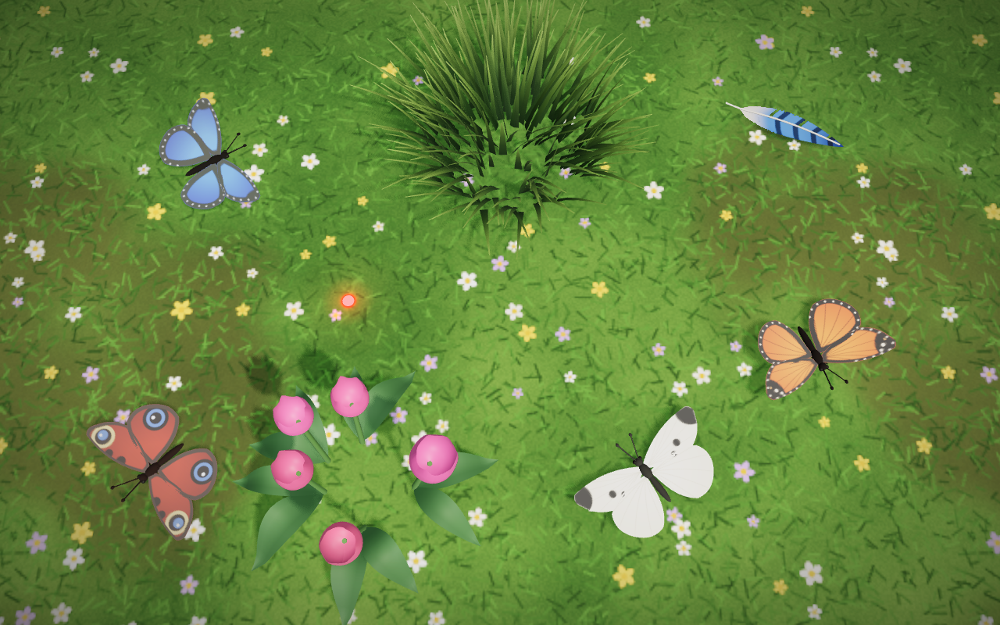
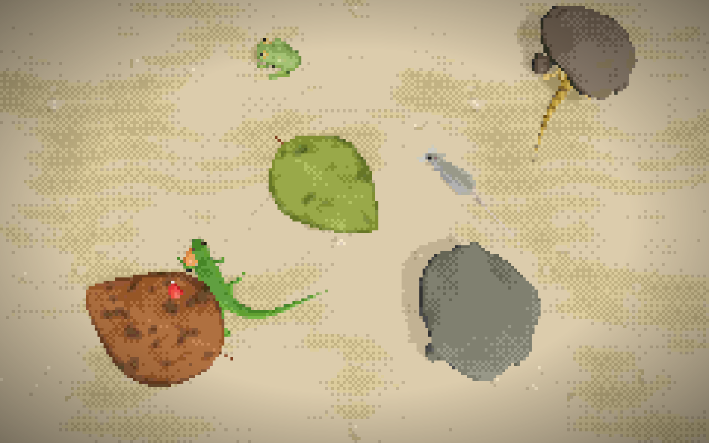
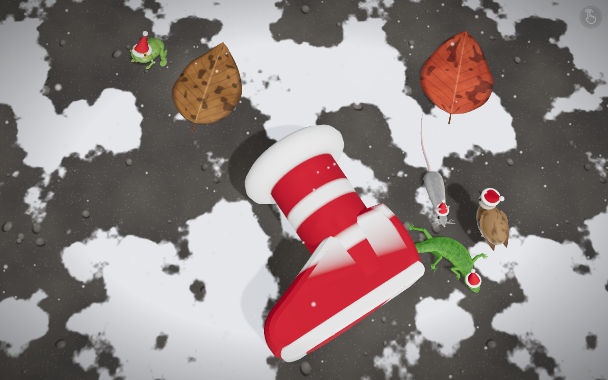
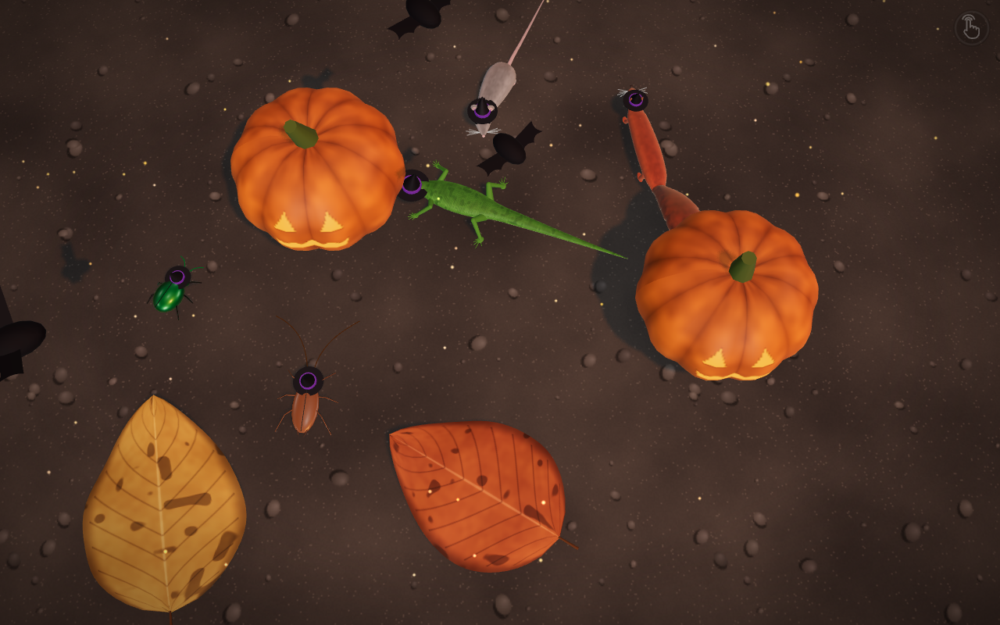
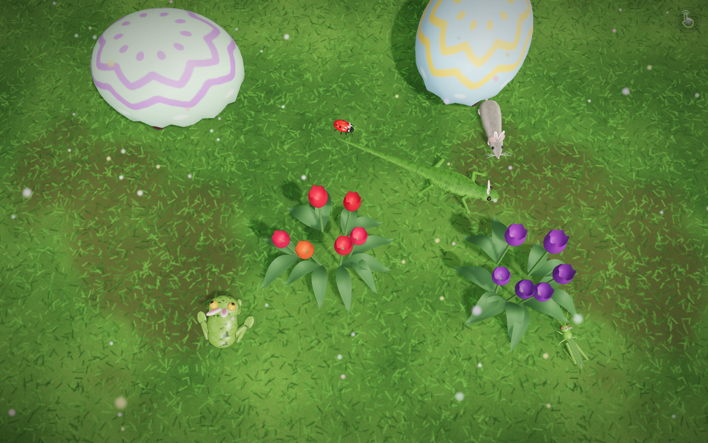
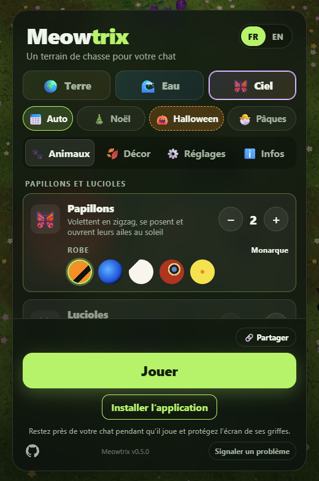
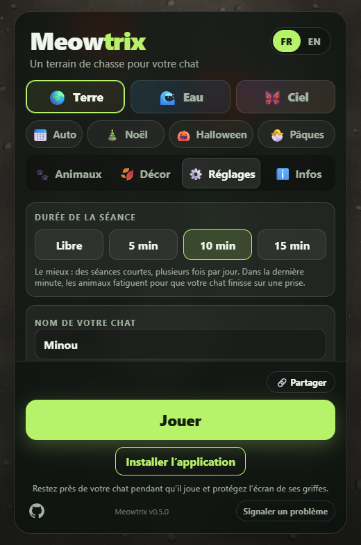

# Meowtrix

**Turn any screen into a hunting ground for your cat.**

Lizards dart between the stones, koi rise to the surface, butterflies flutter just out of reach —
and when a paw lands on one, it bolts. Meowtrix is a free, full-screen game made for cats: lifelike
3D animals that wander, hide and flee, on a phone, a tablet, a laptop or a TV. No download, no
account, no ads.

**👉 Play now: [meowtrix.mbonnici.fr](https://meowtrix.mbonnici.fr/)**


## Why cats love it

- **Prey that behaves like prey.** Every animal is simulated, not animated: a supple spine, legs
  that actually step, a tail that follows. They wander, freeze when something moves, dash for cover
  and peek back out. A touch makes them flee, just like the real thing.
- **Three worlds to hunt in.**
  - **Land** — lizards, frogs, flies, ladybirds, beetles, grasshoppers, cockroaches, mice,
    squirrels and birds.
  - **Water** — goldfish, koi, a shoal of sardines, trout, salmon and baby sharks. A tap sends
    ripples across the pond; fish slip under rocks to hide.
  - **Sky** — butterflies that open their wings in the sun, blinking fireflies, feathers carried by
    the wind, and a laser dot that moves like a real hand: it races, stops dead, circles, slips off
    the screen… and lingers under the paw that catches it.
- **It hears the room.** With the microphone on, animals startle at real noises. Every sound is
  synthesised live, so nothing ever loops.
- **Sessions that end on a win.** Play freely or for 5, 10 or 15 minutes. In the last minute the
  animals tire, and the session ends right after a catch, so your cat finishes satisfied. A catch
  counter keeps score, with your cat's name on it.




## Make it yours

- **Pick the cast.** Choose how many of each animal, and their colours: green anole or leopard
  gecko, orange goldfish or shubunkin, monarch or blue morpho.
- **Set the scene.** Stone, sand, night, concrete, parquet or lawn; pond, lagoon or river; meadow,
  dusk or moonlight. Add hiding spots — leaves, stones, grass, tulips, an old boot big enough for a
  mouse, water lilies, rocks, weeds.
- **Dress it up for the holidays.** Christmas (Santa hats, snow, a stocking to hide in), Halloween
  (witch hats, glowing pumpkins, bats) or Easter (bunny ears, giant eggs, petals). Leave it on
  **Auto** and the right one turns up in season, or pick **None** to keep every day plain.
- **Go retro.** A **Pixel** style turns the scene into chunky, dithered pixel art.
- **Share the fun.** One button sends your cat's score with a link that rebuilds the exact same
  scene on any device.



| Christmas | Halloween | Easter |
| --- | --- | --- |
|  |  |  |

## Works everywhere

- **Any screen**: phones and tablets (where it installs like an app and works offline), computers,
  and TVs, with a menu you can drive with a remote.
- **44 languages**, from English, Spanish and German to Japanese, Arabic, Hindi and Swahili, with
  right-to-left layouts where needed. It opens in your browser's language.
- **Cat-safe by design**: a long press is needed to open the menu, so a paw can't quit the game by
  accident. Phones can vibrate on each catch.

| Animals | Sky | Settings |
| --- | --- | --- |
|  |  |  |

> Stay close to your cat while it plays, and protect the screen from its claws.

---

## For developers

Meowtrix is a single-page app in TypeScript, rendered with [Three.js](https://threejs.org/) and
built with Vite. Sounds use the Web Audio API; there is no backend.

```bash
npm install
npm run dev        # http://localhost:5173
npm run build      # type-checks and writes dist/
```

### Versions

The version shown at the bottom of the menu comes from `package.json` and links to the `/changelog/`
page, which tells players in English what each version brought (written from `seo/changelog.ts`).
The detailed log, in French and with the technical changes, is [CHANGELOG.md](CHANGELOG.md). The
build fails if the version in `package.json` has no entry in `seo/changelog.ts`.

### Docker

```bash
# Local test on http://localhost:8787
docker compose -f docker-compose.yml -f compose.local.yml up --build
```

On Coolify: a **Docker Compose** resource pointing at this repository (`docker-compose.yml`), with
the domain `https://meowtrix.mbonnici.fr` on the `meowtrix` service (port 80). HTTPS is required for
the microphone.

### Search engines and AI assistants

The game is one app, but the build writes a page per theme and per holiday in each of the 44
languages in `src/langs.ts`: French at the root (`/`, `/eau/`, `/ciel/`, `/noel/`, `/halloween/`,
`/paques/`), the others under their code (`/en/water/`, `/de/sky/`, `/pt-br/christmas/`…). Each
page has its own title, description, preview image (`public/og/`), text (the **About** tab),
`hreflang` links to its 43 translations, and the scene it sets up. The texts live in
`seo/locales/<lang>.ts`, the pages in `seo/pages.ts`; `seo/plugin.ts` also writes `sitemap.xml` and
`llms.txt`.

The About text is in the HTML without a `hidden` attribute (only JavaScript hides it outside its
tab), so tools that read pages without running them keep it. Every page also has a Markdown twin
(`/en/index.md`…, written by `seo/markdown.ts`) that nginx serves instead of HTML to
`Accept: text/markdown` requests, and `llms-full.txt` gathers all the text in one file.
`public/robots.txt` welcomes search engines and AI crawlers, and nginx returns a real 404 for
unknown addresses.

### Translations

French and English are in `src/i18n.ts`, the other languages in `src/locales/<lang>.ts`, loaded
only when chosen. Arabic, Hebrew, Persian and Urdu are laid out right to left. To add a language:
one line in `src/langs.ts`, one file in `src/locales/` and one in `seo/locales/` (the build rejects
an incomplete language).

### Layout

| Folder | Role |
| --- | --- |
| `src/catalog.ts` | Themes, species (icon, max count, colours), grounds and hiding spots per theme |
| `src/game/body/` | Shared building blocks: simulated spine, lofted skin, leg IK |
| `src/game/creature.ts` | Base for brain-driven animals (locomotion, collisions) |
| `src/game/brain.ts`, `species.ts` | Behaviour: wandering, alert, flight, hiding; per-species tuning |
| `src/game/lizard/` | Lizards (and long-tailed lizard): body, legs, tongue, procedural skin |
| `src/game/mammal/` | Mouse and squirrel: one parametric body, painted fur |
| `src/game/bug/` | Cockroach and beetle: shell, six legs, antennae |
| `src/game/hopper/` | Frog and grasshopper: moving by leaps |
| `src/game/flyer/` | Fly, ladybird, bird: flight, landing, walking, grooming |
| `src/game/sky/` | Sky theme: butterflies and fireflies (on the flyer engine), feather and laser dot (toys) |
| `src/game/fish/` | Fish: undulating swim, fins, sardine shoal |
| `src/game/covers/` | Hiding spots: lifting leaves, stones, boot, grass, tulips, water lilies, weeds, and the holiday ones |
| `src/game/fete.ts` | Holidays: outfits, snow, petals, embers, bats, lighting |
| `src/game/ground.ts`, `water.ts` | Ground textures; the Water theme's surface, reflections and ripples |
| `src/game/game.ts` | Population, input and sound for the whole scene |
| `src/game/world.ts`, `pixel.ts` | Scene, camera, light, ground; Pixel-style rendering |
| `src/audio/` | Synthesised sounds and microphone listening |
| `src/menu.ts` | Menu: Land / Water / Sky, holidays, Animals, Scenery, Settings and About tabs |
| `src/session.ts`, `preset.ts` | Timed sessions and catch counter; settings in a link (`?theme=sky&animals=laser.red:1…`) |
| `seo/` | Pages per theme and language, sitemap, llms.txt (see above) |
| `public/` | PWA manifest, service worker, icons (`npm run icons` to regenerate), preview images, robots.txt, 404 page |

In the bottom of the menu: the version, the code on GitHub, and a **Report a problem** button that
opens a pre-filled GitHub issue.
