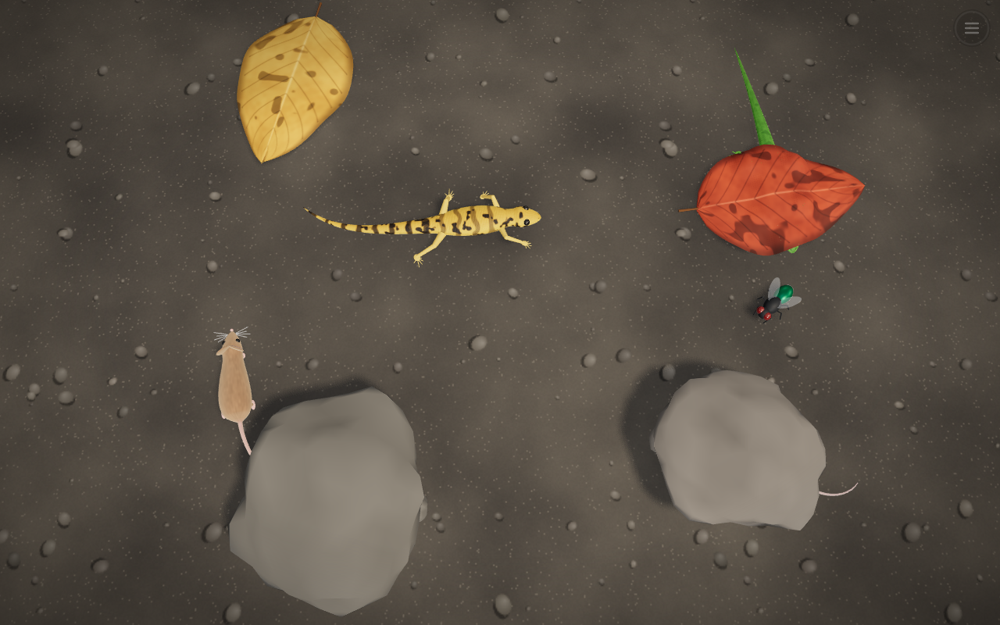
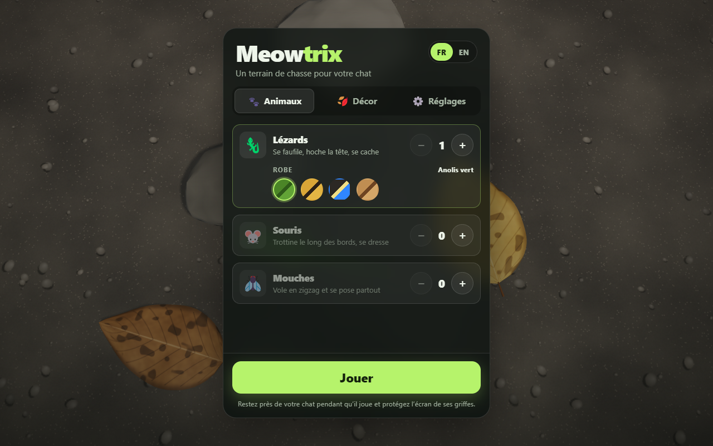
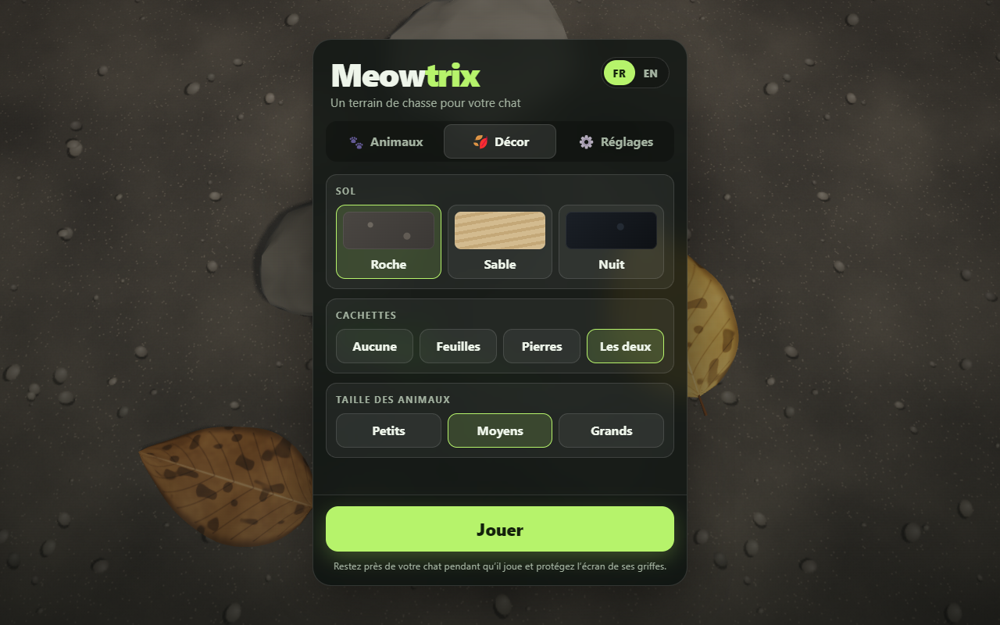
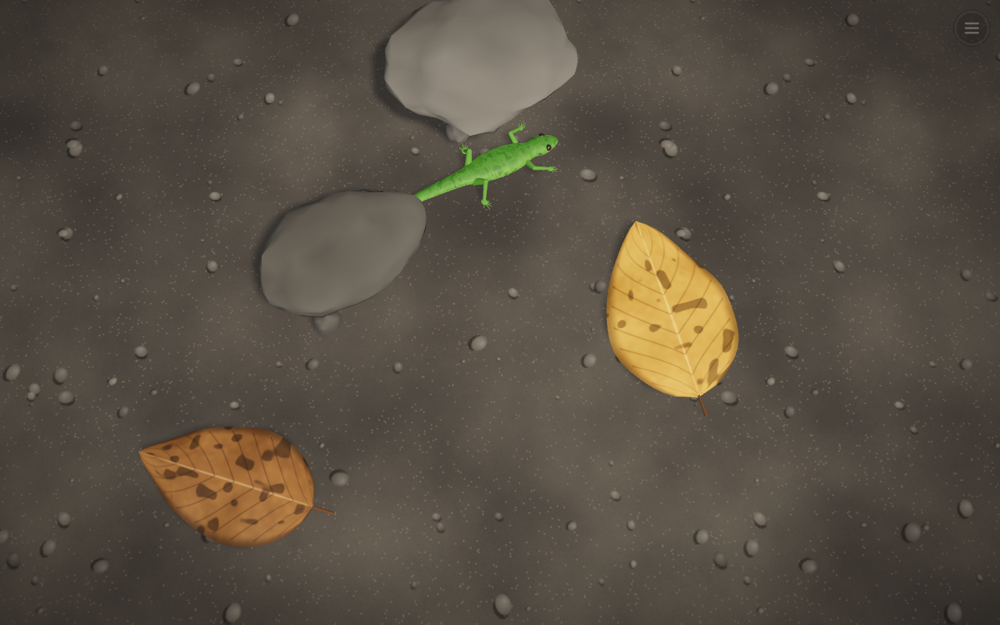

# Meowtrix

Un site plein écran pour faire jouer les chats : des lézards, souris et mouches en 3D (Three.js)
qui se promènent, se cachent sous les feuilles et les pierres, et détalent quand une patte les
touche. Les sons sont synthétisés en direct (Web Audio API) et, si on l'autorise, le micro fait
sursauter les animaux aux bruits de la pièce.

**👉 Jouer : [meowtrix.mbonnici.fr](https://meowtrix.mbonnici.fr/)**



| Menu — Animaux | Menu — Décor |
| --- | --- |
|  |  |



## Développement

```bash
npm install
npm run dev        # http://localhost:5173
npm run build      # vérifie les types et produit dist/
```

## Docker

```bash
# Test local sur http://localhost:8787
docker compose -f docker-compose.yml -f compose.local.yml up --build
```

Sur Coolify : ressource **Docker Compose** pointant sur ce dépôt (`docker-compose.yml`), domaine
`https://meowtrix.mbonnici.fr` sur le service `meowtrix` (port 80). Le HTTPS est nécessaire pour le micro.

## Structure

| Dossier | Rôle |
| --- | --- |
| `src/game/body/` | Briques communes : colonne vertébrale simulée, peau lofée, IK des pattes |
| `src/game/creature.ts` | Base des animaux qui marchent (locomotion, collisions) |
| `src/game/lizard/` | Lézard : corps, pattes, langue, peau procédurale |
| `src/game/mouse/` | Souris : fourrure, oreilles, moustaches, se dresse et renifle |
| `src/game/fly/` | Mouche : vol erratique, atterrissage, toilettage |
| `src/game/brain.ts` | Comportement des animaux au sol : errance, alerte, fuite, cachettes |
| `src/game/covers.ts` | Feuilles (qui se soulèvent sur les animaux) et pierres |
| `src/game/game.ts` | Population, entrées et sons de toute la scène |
| `src/game/world.ts` | Scène, caméra, lumière, sol |
| `src/audio/` | Sons synthétisés et écoute du micro |
| `src/menu.ts` | Menu à onglets (Animaux, Décor, Réglages) |
| `public/` | Manifeste PWA, service worker, icônes (`npm run icons` pour les régénérer) |